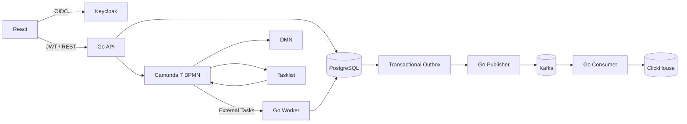

# Vacation Approval

Мини-приложение для согласования отпуска: сотрудник подаёт заявку, Camunda управляет процессом, DMN определяет результат, а событие о решении попадает в Kafka и ClickHouse.

## Запуск

**Требуется:** Docker Desktop с Docker Compose. Go, Node.js и PostgreSQL локально устанавливать не нужно.

```bash
docker compose up -d --build
```

Проверить, что все сервисы готовы:

```bash
docker compose run --rm smoke
```

Первая сборка скачивает Docker-образы и зависимости. Данные хранятся в Docker volumes.

| Интерфейс | Адрес | Учётная запись для демо |
|---|---|---|
| Приложение | http://localhost:5173 | `employee / employee123` или `manager / manager123` |
| Camunda Tasklist | http://localhost:8081/camunda/app/tasklist/default/ | `demo / demo` |
| Swagger API | http://localhost:8080/swagger/index.html | Bearer JWT из Keycloak |
| Keycloak Admin | http://localhost:8082/admin/ | `admin / admin` |

## Проверка процесса

1. Откройте приложение под **employee**, создайте отпуск на 5 календарных дней. Начальный баланс демо-сотрудника — 20 дней.
2. Заявка перейдёт в состояние **«Ожидает руководителя»**. Под **manager** она видна в списке ожидающих заявок.
3. В Camunda Tasklist откройте соответствующую задачу `Manager approval`, выберите **Approve** и завершите задачу.
4. Вернитесь в приложение под **employee**, нажмите **«Обновить»**. Итог — `approved`, остаток баланса — 15 дней.
5. Проверьте событие в ClickHouse:

```bash
docker compose exec clickhouse clickhouse-client --user vacation --password vacation -q "SELECT request_id, days, decision FROM vacation.decisions FINAL ORDER BY event_id DESC LIMIT 5"
```

## Бизнес-правила

| Условие | Результат |
|---|---|
| Баланса хватает, 1–2 дня | `auto_approved`, списание дней без менеджера |
| 3–14 дней, менеджер одобрил | `approved`, списание дней |
| Менеджер отказал или баланса недостаточно | `rejected`, без списания |
| Более 14 дней, менеджер одобрил | `needs_hr_review`, без списания до HR |

Дни календарные, даты включительно. HR-согласование в этом срезе обозначено статусом; отдельная HR-задача не реализована.

## Архитектура



Go-код разделён на `internal/api` (HTTP и JWT), `internal/core/vacation` (правила и сценарии) и `internal/integration` (БД, Camunda, Kafka, ClickHouse). Определения процесса и решений находятся в `process/vacation.bpmn` и `process/vacation.dmn`.

PostgreSQL — источник истины. Списание дней, итоговый статус и outbox-событие фиксируются одной транзакцией. Повторная обработка не приводит к повторному списанию; Kafka работает по схеме *at-least-once*, ClickHouse дедуплицирует события по `event_id`.

## Тесты и остановка

```bash
docker compose run --rm tests
docker compose down
```

Тесты используют отдельную БД `vacation_test`; `down` сохраняет данные. Команды `make up`, `make verify`, `make test`, `make down` доступны как сокращения, если установлен GNU Make.

**Ограничения демоверсии:** HTTP и тестовые пароли — только для локального запуска; учётная запись Camunda Tasklist отделена от Keycloak; Redis не используется ввиду отсутствия потребности в кэше. Camunda 7 CE выбрана из-за требования External Tasks, несмотря на завершение поддержки Community Edition.
